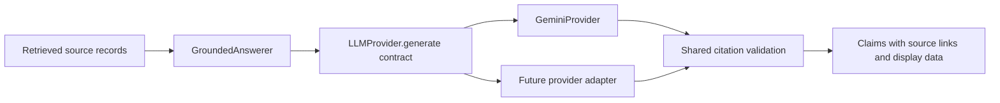

# Grounded answers with a pluggable model provider

The user selected Gemini and explicitly requested an abstract provider class.
The first adapter is Gemini; no OpenAI adapter or dependency was added.

## Theory

Retrieval supplies evidence. Generation turns that evidence into an answer.
The generator is an interchangeable dependency. `GroundedAnswerer` accepts an
`LLMProvider` and calls `generate(GenerationRequest)`. A concrete adapter translates
that request into its vendor's API call and returns a common `GenerationResult`.
This is dependency inversion: the answer pipeline depends on a shared contract.



The model returns claims with source IDs and short supporting quotes. The pipeline
checks that each ID belongs to the retrieved context and each quote occurs in that
source's text, allowing whitespace differences. Page numbers and PDF links come
from the original records. The model cannot provide replacement page metadata.
Table rows and diagram image paths are preserved for future rendering.

These checks verify references and quote integrity. Whether a quote actually
supports the claim is still an answer-quality question. Prompt instructions ask
for insufficient evidence where appropriate, preserve OCR uncertainty, and forbid
invented numbers or automatic diagram interpretation. No-source keyword results
skip model generation completely. Semantic nearest neighbors can still exist for
unsupported questions, so the model must assess relevance of the supplied context.

## Preview without a key or extra packages

From the active `rag-is-code` repository:

```bash
python scripts/answer.py "What are accidental loads?" --method keyword --preview
```

This prints the retrieved evidence, the exact prompt, and the output schema. It
does not generate an answer or contact a model API. `--method keyword` needs only
Python's standard library. The default retrieval method is hybrid and needs the
optional dependencies from `requirements-search.txt`.

## Run Gemini

Install its SDK in your Python environment:

```bash
python -m pip install -r requirements-llm.txt
```

Set `GEMINI_API_KEY` in your local terminal environment. Alternatively, copy
`.env.example` to `.env`, fill in the key locally, and export that configuration:

```bash
set -a
source .env
set +a
```

Scripts read exported environment variables; `.env` is not loaded automatically.
It is ignored by Git. Do not put the key in source code. `GOOGLE_API_KEY` is also
accepted if `GEMINI_API_KEY` is absent. Configure these once per terminal session.

Then run:

```bash
python scripts/answer.py "What are accidental loads?" --method keyword
python scripts/answer.py "What are the clearances for fastener holes?" --method hybrid --json
```

The first command needs the Gemini SDK only; the second also uses the semantic
search dependencies. Generation sends the question and selected evidence to
Google. No entire PDF or diagram pixels are uploaded by this implementation.

The primary model is `gemini-3.8-flash`. The default fallback models, in order,
are `gemini-3.6-flash`, `gemini-3.5-flash-lite`, and `gemini-3.1-flash-lite`.
These text-generation models were checked against Google's official
[model documentation](https://ai.google.dev/gemini-api/docs/models) and the
configured key's model listing. The adapter uses Google's
[generateContent API](https://ai.google.dev/api/generate-content) with a JSON
schema. Model availability and quota still depend on your API account.

## Change provider or model

Model selection needs no code change:

```bash
export LLM_PROVIDER=gemini
export LLM_MODEL=gemini-3.8-flash
export LLM_FALLBACK_MODELS=gemini-3.6-flash,gemini-3.5-flash-lite,gemini-3.1-flash-lite
```

`--provider` and `--model` override those environment variables per invocation.
`GEMINI_MODEL` is an alternate way to configure the primary when `LLM_MODEL` is
unset. Defaults are resolved by the factory and adapter, not by retrieval or
grounding code.

`LLM_FALLBACK_MODELS` replaces the default fallback list. Empty entries and
duplicate model IDs are skipped. An empty value disables fallback. You can also
override or disable fallback for one invocation:

```bash
python scripts/answer.py "What are accidental loads?" --fallback-models gemini-3.5-flash-lite,gemini-3.1-flash-lite
python scripts/answer.py "What are accidental loads?" --no-fallback
```

The factory wraps the adapters in `FallbackProvider`. It tries the same prepared
request with each configured model until one succeeds. Gemini marks model-not-found
(404), timeout (408), rate-limit (429), and transient server errors (500, 502, 503,
504), plus transport failures, as recoverable. Each model gets one attempt with a
30-second HTTP timeout; SDK retries are disabled so attempts do not multiply.
Invalid requests, authentication errors, payment errors, and permission errors
(400, 401, 402, 403) stop immediately. Blocked, malformed, and uncited responses
are still rejected. A fallback does not bypass citation validation.

Model switches appear on stderr. `generation.model` identifies the answering
model, and `generation.attempts` lists failed models with HTTP codes and the final
success. If every model fails, the error lists the attempted models and sanitized
failure codes. Raw vendor errors and credentials are never included in these logs.
Fallback cannot resolve a provider-wide outage or quota shared by all models.
The error classification follows Google's
[troubleshooting guidance](https://ai.google.dev/gemini-api/docs/troubleshooting).

A new provider implements the abstract contract:

```python
from rag_demo.providers import LLMProvider, GenerationResult

class AnotherProvider(LLMProvider):
    def __init__(self, model=None):
        self.model = model  # Configure the vendor SDK here.

    def generate(self, request):
        # Send request.system_instruction, request.prompt and request.response_schema.
        # Parse the vendor response into a dictionary named data.
        return GenerationResult(data=data, provider="another", model=self.model)
```

This is an interface illustration, not a complete adapter. Save a concrete
implementation in an importable module, then select `module.path:AnotherProvider`
as `LLM_PROVIDER`. No factory edit is required. Each adapter accepts `model=None`,
handles its credentials and SDK, and raises `ProviderError` for provider failures.
Citation validation remains shared. Only Gemini is implemented for live use today.
The fallback wrapper is provider-independent. Custom adapters can opt into model
fallbacks by exposing their selected `model` and raising
`ProviderError(..., retryable=True, status_code=...)` for recoverable failures.

## Verification and checkpoint

Offline tests cover alternate-provider injection, abstract-class enforcement,
unknown source IDs, fabricated quotes, uncited claims, no-evidence handling,
metadata preservation, ordered model fallback, exhausted chains, configuration
overrides, authentication failures and sanitized error reporting:

```bash
python -m unittest discover -s tests -v
```

With the Gemini SDK installed, the suite also exercises its actual serialization
and parsing through a mocked HTTP transport: the first model returns 503 and the
second succeeds. This verifies that hidden SDK retries do not repeat the first
model. That test does not contact Gemini. Without the optional SDK, that one test
is skipped; the remaining tests need only Python's standard library.

On 2026-10-27, all 23 tests passed in `.venv`. A live hybrid query, "What are
accidental loads?", then exercised actual failover: `gemini-3.8-flash` returned
504 and `gemini-3.6-flash` answered successfully. The answer's quotes passed shared
validation against clauses 1.3.1 (PDF page 15) and 3.2.1 (PDF page 29), and the
claims were checked against those passages. The complete local result is saved
in ignored `.cache/live_test_answer.json`. This validates one real fallback, not
the availability or answer quality of every configured model. Review the cited
answer before building the interactive interface and clarification flow.
