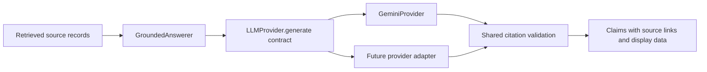

# Grounded answers with a pluggable model provider

The user selected Gemini and explicitly requested an abstract provider class.
The first adapter is Gemini; no OpenAI adapter or dependency was added.

## Theory

Retrieval supplies evidence. Generation turns that evidence into an answer.
The generator is an interchangeable dependency. `GroundedAnswerer` accepts an
`LLMProvider` and calls `generate(GenerationRequest)`. A concrete adapter translates
that request into its vendor's API call and returns a common `GenerationResult`.
This is dependency inversion: the answer pipeline depends on a shared contract.



The model returns claims with source IDs and short supporting quotes. The pipeline
checks that each ID belongs to the retrieved context and each quote occurs in that
source's text, allowing whitespace differences. Page numbers and PDF links come
from the original records. The model cannot provide replacement page metadata.
Table rows and diagram image paths are preserved for future rendering.

These checks verify references and quote integrity. Whether a quote actually
supports the claim is still an answer-quality question. Prompt instructions ask
for insufficient evidence where appropriate, preserve OCR uncertainty, and forbid
invented numbers or automatic diagram interpretation. No-source keyword results
skip model generation completely. Semantic nearest neighbors can still exist for
unsupported questions, so the model must assess relevance of the supplied context.

## Preview without a key or extra packages

From the active `rag-is-code` repository:

```bash
python scripts/answer.py "What are accidental loads?" --method keyword --preview
```

This prints the retrieved evidence, the exact prompt, and the output schema. It
does not generate an answer or contact a model API. `--method keyword` needs only
Python's standard library. The default retrieval method is hybrid and needs the
optional dependencies from `requirements-search.txt`.

## Run Gemini

Install its SDK in your Python environment:

```bash
python -m pip install -r requirements-llm.txt
```

Set `GEMINI_API_KEY` in your local terminal environment. Alternatively, copy
`.env.example` to `.env`, fill in the key locally, and export that configuration:

```bash
set -a
source .env
set +a
```

Scripts read exported environment variables; `.env` is not loaded automatically.
It is ignored by Git. Do not put the key in source code. `GOOGLE_API_KEY` is also
accepted if `GEMINI_API_KEY` is absent. Configure these once per terminal session.

Then run:

```bash
python scripts/answer.py "What are accidental loads?" --method keyword
python scripts/answer.py "What are the clearances for fastener holes?" --method hybrid --json
```

The first command needs the Gemini SDK only; the second also uses the semantic
search dependencies. Generation sends the question and selected evidence to
Google. No entire PDF or diagram pixels are uploaded by this implementation.

The default model is `gemini-3.8-flash`, currently listed in Google's official
[model documentation](https://ai.google.dev/gemini-api/docs/models). The adapter
uses Google GenAI's documented [generateContent API](https://ai.google.dev/api/generate-content)
with a JSON schema. Model availability and quota depend on your API account.

## Change provider or model

Model selection needs no code change:

```bash
export LLM_PROVIDER=gemini
export LLM_MODEL=gemini-3.8-flash
```

`--provider` and `--model` override those environment variables per invocation.
`GEMINI_MODEL` supplies a Gemini-specific fallback. Defaults are resolved by the
factory and adapter, not by retrieval or grounding code.

A new provider implements the abstract contract:

```python
from rag_demo.providers import LLMProvider, GenerationResult

class AnotherProvider(LLMProvider):
    def __init__(self, model=None):
        self.model = model  # Configure the vendor SDK here.

    def generate(self, request):
        # Send request.system_instruction, request.prompt and request.response_schema.
        # Parse the vendor response into a dictionary named data.
        return GenerationResult(data=data, provider="another", model=self.model)
```

This is an interface illustration, not a complete adapter. Save a concrete
implementation in an importable module, then select `module.path:AnotherProvider`
as `LLM_PROVIDER`. No factory edit is required. Each adapter accepts `model=None`,
handles its credentials and SDK, and raises `ProviderError` for provider failures.
Citation validation remains shared. Only Gemini is implemented for live use today.

## Verification and checkpoint

Offline tests cover alternate-provider injection, abstract-class enforcement,
unknown source IDs, fabricated quotes, uncited claims, no-evidence handling,
metadata preservation and provider error handling:

```bash
python -m unittest discover -s tests -v
```

The actual Google SDK was also exercised with a mocked HTTP transport, including
request serialization and response parsing. That is not a live Gemini answer.
No Gemini key was configured during implementation, so live generation still
needs a user-run check. Review one cited answer before building the interactive
interface and clarification flow.
